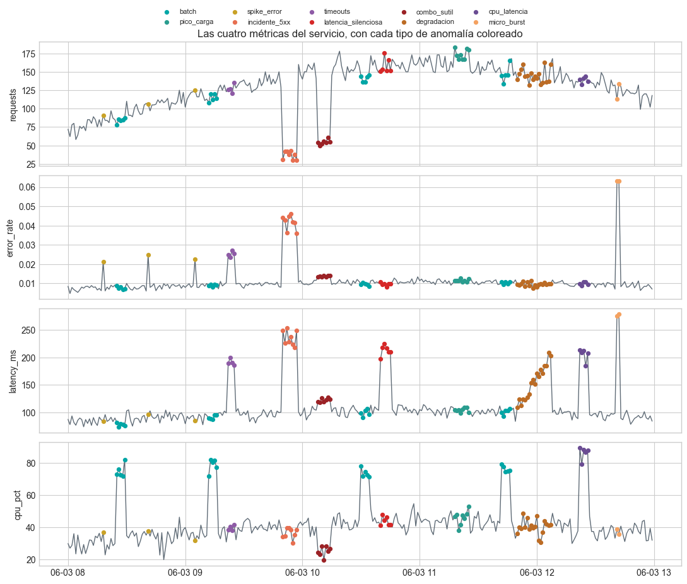
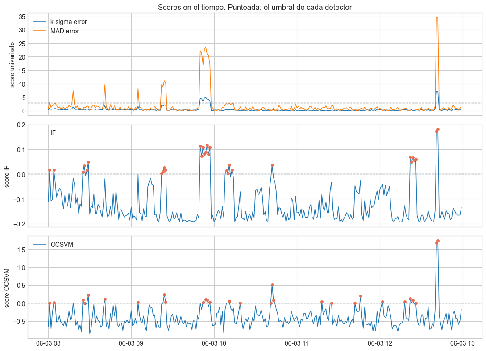
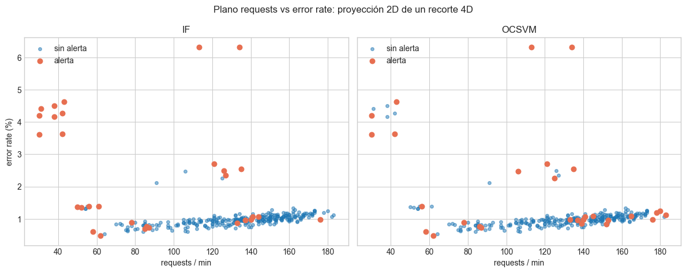

# Detección de anomalías

Cómo cumple PharmaGo el ítem "Técnicas de detección de anomalías" de la rúbrica: IsolationForest y Support Vector Machine con núcleo RBF sobre el dataset provisto por los docentes.

El código está en [`anomaly-detection/`](../Implementacion%20K8S/Codigo/anomaly-detection/). El análisis completo, ejecutado y con sus salidas, está en la notebook [`comparacion_detectores.ipynb`](../Implementacion%20K8S/Codigo/anomaly-detection/notebooks/comparacion_detectores.ipynb). Las gráficas y los números de este documento salen de esa notebook.

## Qué se implementó

| Archivo | Qué hace |
|---|---|
| `anomaly_detection/detectors.py` | `fit_isolation_forest` (300 árboles) y `fit_one_class_svm` (`kernel="rbf"`), cada uno en un pipeline con `StandardScaler`. `detect` devuelve un score, donde mayor es más anómalo, y una flag. |
| `anomaly_detection/baselines.py` | Líneas base univariadas: k-sigma y z-score robusto (MAD). |
| `anomaly_detection/evaluation.py` | Precision, recall, F1 y average precision contra las etiquetas, alertas por tipo de anomalía y minuto de la primera alerta. |
| `anomaly_detection/synthetic.py` | El generador del dataset de los docentes. Con la semilla 42 reproduce exactamente los mismos datos. |

## Dataset

Un servicio de checkout con una fila por minuto: 300 minutos, 53 anómalos (17,7%). Tiene cuatro features (`requests`, `error_rate`, `latency_ms` y `cpu_pct`) y trae etiquetas, que se usan solo para evaluar.

Incluye anomalías fáciles (`incidente_5xx`, `micro_burst`), combinaciones raras donde ningún eje es extremo (`combo_sutil`), una degradación lenta y dos trampas operativas que no son incidentes (`batch` y `pico_carga`).



## Resultados

Los detectores se entrenan sin etiquetas sobre las 300 ventanas, con `contamination=0.10` y `nu=0.10`: un presupuesto de unas 30 alertas.

| Detector | Precision | Recall | F1 | Average precision | Alertas |
|---|---|---|---|---|---|
| IsolationForest | 0,80 | 0,45 | 0,58 | 0,77 | 30 |
| One-Class SVM RBF | 0,62 | 0,34 | 0,44 | 0,58 | 29 |
| MAD sobre latencia | 1,00 | 0,68 | 0,81 | 0,94 | 36 |
| k-sigma sobre error rate | 1,00 | 0,19 | 0,32 | 0,49 | 10 |

Con el mismo presupuesto, IsolationForest gasta mejor sus alertas: 2 falsos positivos en minutos normales o de pico contra 6 de One-Class SVM, y detecta los 8 minutos del incidente 5xx contra 4.

En este dataset, la línea base MAD sobre latencia rinde mejor que los dos (F1 0,81), porque casi todas las anomalías mueven la latencia. No ve `combo_sutil` ni los `spike_error`, y depende de saber de antemano qué métrica mirar.



En el plano requests contra error rate se ve la diferencia. IsolationForest alerta lo que queda fuera de la relación habitual (poco tráfico con mucho error). One-Class SVM también alerta los extremos de la nube normal, como el pico de carga.



## Sensibilidad y features

- **Presupuesto de alertas.** Es la palanca principal. Con 0,20, el F1 de IsolationForest sube a 0,69 y el de One-Class SVM a 0,64. En IsolationForest el ranking no cambia: la average precision queda en 0,77 para cualquier `contamination`.
- **`gamma` del núcleo RBF.** One-Class SVM es sensible: el F1 va de 0,36 con 0,01 a 0,50 con 0,1, y `scale` da 0,44.
- **Features relativas a la carga.** Reemplazar cada métrica por su residuo contra `requests` sube la precision de IsolationForest de 0,80 a 0,87, y sumar la tendencia del residuo de latencia sube su average precision a 0,84.

## Conclusiones

- IsolationForest fue más estable que One-Class SVM en F1 y en average precision.
- Los detectores multivariados ven lo que los univariados no: `combo_sutil` no cruza el umbral en ningún eje, e IsolationForest alerta 4 de sus 7 minutos.
- Ninguno ve la degradación lenta, porque evalúa cada minuto por separado. Hace falta una feature de tendencia o un detector de cambios acumulados (CUSUM, EWMA).
- Los modos operativos legítimos, como los jobs batch, necesitan contexto que las métricas no traen.

## Cómo reproducirlo

Desde `Implementacion K8S/Codigo/anomaly-detection`, con el entorno del [README](../Implementacion%20K8S/Codigo/anomaly-detection/README.md):

```bash
python -m pytest
python -m nbconvert --to notebook --execute --inplace notebooks/*.ipynb
```
