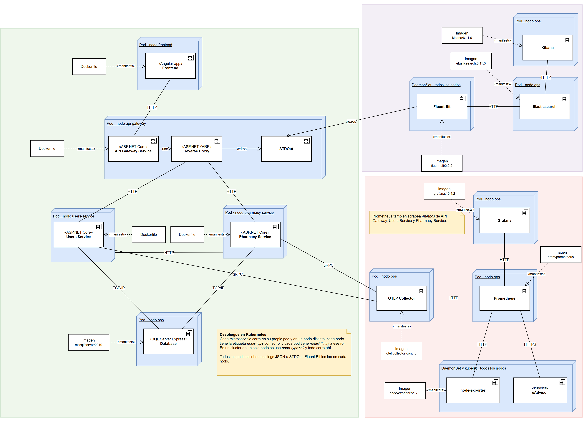

# Implementación de plataforma

Cómo cumple PharmaGo el ítem "Implementación de plataforma" de la rúbrica: el sistema corre sobre Kubernetes, cada microservicio en un pod independiente y en un nodo físico distinto.

La guía general de despliegue (cluster de un nodo, imágenes, port-forward, troubleshooting) está en [README-k8s.md](../Implementacion%20K8S/Codigo/k8s/README-k8s.md).

## Diagrama de despliegue



La fuente editable está en [despliegue-k8s.drawio](diagramas/despliegue-k8s.drawio) y se abre con [draw.io](https://app.diagrams.net).

## Un pod por microservicio

Cada componente tiene su propio Deployment en [`k8s/deployments/`](../Implementacion%20K8S/Codigo/k8s/deployments), así que corre en un pod independiente: `pharmago-ui`, `pharmago-api-gateway`, `pharmago-users-service`, `pharmago-pharmacy-service`, `pharmago-db` y los componentes de observabilidad.

## Un nodo por microservicio

Cada pod declara en qué nodos puede correr con una `nodeAffinity` sobre la etiqueta `node-type` del nodo:

| Rol (`node-type`) | Pods |
|---|---|
| `api-gateway` | pharmago-api-gateway |
| `users-service` | pharmago-users-service |
| `pharmacy-service` | pharmago-pharmacy-service |
| `frontend` | pharmago-ui |
| `ops` | pharmago-db, otlp-collector, prometheus, grafana, elasticsearch, kibana (y los PersistentVolumes) |
| cualquiera | fluent-bit, node-exporter (DaemonSets: un pod por nodo) |

Un nodo tiene un único valor de `node-type`. Por eso, en un cluster con un rol por nodo, dos microservicios distintos nunca comparten nodo. Las réplicas de un mismo microservicio sí pueden compartirlo, o repartirse entre varios nodos con el mismo rol.

Cada pod acepta además el valor `all`, que se usa solo en el cluster de un nodo: `apply-k8s.sh` y `apply-k8s.ps1` etiquetan ese nodo con `node-type=all` y todo corre ahí. Con varios nodos los scripts no etiquetan nada y los roles se asignan a mano.

## Despliegue en varios nodos

Se necesita al menos un nodo por rol: `ops`, `api-gateway`, `users-service`, `pharmacy-service` y `frontend` (5 nodos). Los comandos se ejecutan desde `Implementacion K8S/Codigo/k8s`.

### 1. Crear el cluster

```bash
minikube start --nodes 5 --memory=6144 --cpus=2
```

En Minikube, `--memory` y `--cpus` se aplican a cada nodo, así que este ejemplo reserva unos 30GB de RAM en total. El nodo `ops` es el único que necesita los ~6GB (Elasticsearch, Kibana y SQL Server); a los nodos de microservicios les alcanza con ~1,5GB. Fuera de Minikube, dimensionar cada nodo según su rol.

`minikube image load` (lo usa `build-images.sh`) carga las imágenes en todos los nodos, así que `imagePullPolicy: Never` sigue funcionando.

### 2. Etiquetar los nodos

```bash
kubectl label nodes minikube node-type=ops --overwrite
kubectl label nodes minikube-m02 node-type=api-gateway --overwrite
kubectl label nodes minikube-m03 node-type=users-service --overwrite
kubectl label nodes minikube-m04 node-type=pharmacy-service --overwrite
kubectl label nodes minikube-m05 node-type=frontend --overwrite
```

No usar `node-type=all` en un cluster de varios nodos: un nodo con `all` acepta cualquier microservicio y se pierde la separación.

### 3. Desplegar y verificar

```bash
./build-images.sh
./apply-k8s.sh
kubectl get nodes -L node-type
kubectl get pods -n pharmago -o wide
```

La columna `NODE` de `kubectl get pods -o wide` tiene que mostrar un nodo distinto para cada microservicio.
