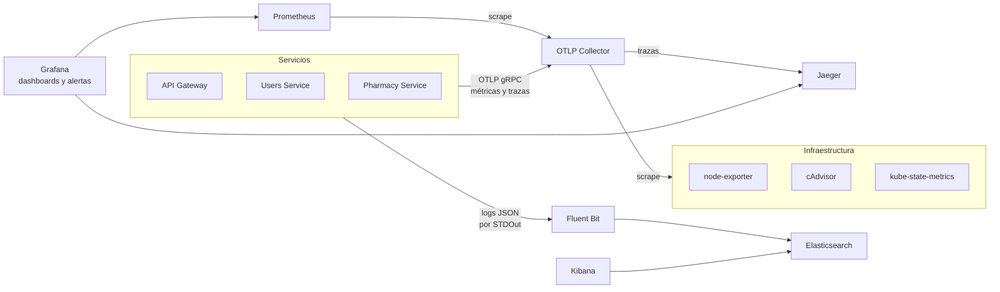

# Telemetría

Cómo cumple PharmaGo el ítem "Telemetría" de la rúbrica: qué señales emite cada componente, por dónde viajan, dónde se consultan y qué alertas las vigilan. Las alertas de Grafana son parte de este ítem; el ítem "Técnicas de detección de anomalías" pide otra cosa (IsolationForest y SVM con núcleo RBF sobre datasets de los docentes) y no se cubre acá.

## Qué pide la letra y cómo se cumple

| Requisito | Cómo se cumple |
|---|---|
| Logs estructurados en JSON, consultables en una herramienta de logs | Los tres servicios loguean en JSON a STDOut. Fluent Bit los lleva a Elasticsearch y se consultan en Kibana. |
| Trazas según OTLP, con propagación de contexto | Los servicios exportan trazas por OTLP al collector, que las envía a Jaeger. El contexto viaja entre servicios con el header W3C `traceparent`. |
| Métricas de pod/contenedor y de nodo: CPU, memoria, storage y red | cAdvisor (por pod y contenedor), node-exporter (por nodo) y kube-state-metrics (reinicios y réplicas). |
| Métricas recolectadas con OTLP hacia Prometheus y visualizadas en Grafana | Todas las métricas pasan por el OTLP Collector, que es el único target de Prometheus. Grafana tiene tres dashboards provisionados. |
| Al menos 5 alertas de anomalías | 7 alertas de Grafana provisionadas como código, verificadas con los scripts de caos. |

## Flujo de las señales

Dónde corre cada componente (nodo, imagen y protocolo de cada conexión) está en el [diagrama de despliegue](implementacion-de-plataforma.md#diagrama-de-despliegue).

## Métricas

Los servicios configuran OpenTelemetry con una sola extensión compartida (`AddPharmaGoOpenTelemetry`, en `Backend/Instrumentation`). Exportan por OTLP cada 10 segundos (`OTEL_EXPORTER_OTLP_ENDPOINT` y `OTEL_METRIC_EXPORT_INTERVAL`) y no exponen `/metrics`.

El collector recibe esas métricas, scrapea las fuentes de infraestructura con el receiver `prometheus` y publica todo en un único endpoint. Prometheus solo scrapea al collector, con `honor_labels: true`, así cada serie conserva el `job` de su origen:

| `job` | Origen | Ejemplos |
|---|---|---|
| `PharmaGo.ApiGateway`, `PharmaGo.UsersService`, `PharmaGo.PharmacyService` | OTLP | `http_server_request_duration_seconds_*`, `http_client_request_duration_seconds_*`, `pharmago_http_requests_total` |
| `kubernetes-cadvisor` | cAdvisor | `container_cpu_usage_seconds_total`, `container_memory_working_set_bytes`, `container_network_*`, `container_fs_writes_bytes_total` |
| `node-exporter` | node-exporter | `node_cpu_seconds_total`, `node_memory_MemAvailable_bytes`, `node_filesystem_avail_bytes`, `node_network_*` |
| `kube-state-metrics` | kube-state-metrics | `kube_pod_container_status_restarts_total`, `kube_deployment_status_replicas_available`, `kube_pod_container_resource_limits` |

El storage por pod se mide como escritura a disco (`container_fs_writes_bytes_total`), junto con el disco disponible del nodo: con containerd, cAdvisor no publica el uso de disco por contenedor (`container_fs_usage_bytes`).

### Dashboards

Los tres se provisionan desde `grafana/provisioning/dashboards/`, la misma carpeta para Compose y Kubernetes.

| Dashboard | Qué muestra |
|---|---|
| PharmaGo - Servicios | Señales doradas por servicio: tráfico, latencia p95, errores 5xx y 4xx, latencia de las llamadas entre servicios, tráfico por endpoint del gateway. |
| PharmaGo - Infra | CPU, memoria y disco del nodo; CPU, memoria, red rx/tx y escritura a disco por pod; red del nodo; reinicios de pods; réplicas por deployment. |
| PharmaGo - Overview | Las métricas propias del proyecto base (`pharmago_http_*`): peticiones, latencia y errores por endpoint, rate limit (429). |

## Trazas

Cada request genera spans de ASP.NET Core, de las llamadas HTTP entre servicios y de las consultas a SQL Server. El gateway (YARP) propaga el contexto con `traceparent`, así una traza muestra el recorrido completo, por ejemplo `PharmaGo.ApiGateway` → `PharmaGo.UsersService` → `PharmaDb`.

Se consultan en Jaeger, o desde Grafana con el datasource de Jaeger. Jaeger quedó en la versión 2.14.1 porque la 2.15 eliminó la API que usa ese datasource.

## Logs

Los tres servicios loguean en JSON con el formatter de consola de .NET. Cada línea trae `TraceId` y `SpanId` en `Scopes`, sin código extra: el host de .NET los agrega a partir de la traza activa.

Fluent Bit corre en cada nodo, parsea el formato de logs de containerd (CRI) y separa los campos del JSON antes de enviarlos a Elasticsearch (índice `pharmago-logs-*`).

### De una traza a sus logs, y al revés

- En Kibana, `Scopes.TraceId : "<trace id de Jaeger>"` devuelve todos los logs de esa request, de todos los servicios.
- Desde un log de error, el valor de `Scopes.TraceId` se busca en Jaeger para ver qué span falló.

El paso a paso está en [cómo revisar logs en Kibana](../Implementacion%20K8S/Codigo/tutoriales/como-revisar-logs-kibana.md#5-ver-los-logs-de-una-traza).

## Alertas de anomalías

Las 7 alertas están en `grafana/provisioning/alerting/pharmago-alerts.yaml`. Grafana las evalúa cada 10 segundos y las lee al arrancar: después de cambiarlas hay que reiniciar Grafana.

| Alerta | Condición | Espera | Script de caos que la dispara |
|---|---|---|---|
| Errores 5xx por servicio | más del 5% de los requests con 5xx | 1 min | `db-freeze.sh`, o escalar `pharmago-db` a 0 |
| Latencia p95 alta por servicio | p95 mayor a 1 s, con más de 1 req/s | 1 min | `db-freeze.sh` |
| CPU de un pod de la app cerca del límite | más del 80% del límite de CPU | 30 s | `cpu-spike.sh` |
| Memoria de un pod de la app cerca del límite | más del 80% del límite de memoria | 30 s | `ram-spike.sh` |
| Escritura a disco anómala en un pod de la app | más de 2 MB/s | inmediata | `volume-spike.sh` |
| Deployment sin réplicas disponibles | 0 réplicas disponibles | 30 s | escalar un deployment a 0 |
| Reinicios de pods | algún reinicio en los últimos 5 minutos | inmediata | `ram-spike.sh` por encima del límite (OOMKill) |

"Pods de la app" son el gateway, Users, Pharmacy y el frontend. SQL Server y Elasticsearch usan memoria como caché hasta su límite, y Elasticsearch tiene picos de CPU al indexar: para ellos esos valores son normales.

### Verificación

Se verificaron en minikube corriendo cada script de caos y mirando el estado de la alerta en Grafana:

- Seis alertas pasan a `firing` y se resuelven al terminar el caos: CPU, memoria, escritura a disco, reinicios, errores 5xx y deployment sin réplicas.
- La de latencia llegó a `pending`, con un p95 de 10 s, con la base congelada, pero no pasó a `firing` en el tiempo de prueba. Bajo CPU saturada, Users se degrada con errores rápidos más que con latencia: el p95 máximo medido fue de 0,24 s, contra menos de 0,1 s en reposo. El umbral se mantuvo en 1 s para no tener falsos positivos.

### Lo que hay que saber al probarlas

- Los scripts de caos están en `chaos-engineering/` y necesitan el port-forward activo.
- El gateway limita a 100 requests por minuto y 1000 por hora por IP. Para probar 5xx y latencia hay que pegarle directo a Users (`127.0.0.1:5001`); por el gateway, lo que se mide es el rate limit (429).
- Después de un OOMKill, la alerta de memoria tarda hasta 5 minutos en resolverse: el collector sigue publicando la última serie del contenedor muerto durante ese tiempo (`metric_expiration`).

## Dónde se consulta cada señal

Con `./port-forward.sh` corriendo desde `Implementacion K8S/Codigo/k8s`:

| Señal | Herramienta | URL |
|---|---|---|
| Métricas, dashboards y alertas | Grafana (admin/admin) | http://127.0.0.1:3000 |
| Métricas (PromQL) | Prometheus | http://127.0.0.1:9090 |
| Trazas | Jaeger | http://127.0.0.1:16686 |
| Logs | Kibana | http://127.0.0.1:5601 |

Más detalle en los tutoriales de [Prometheus](../Implementacion%20K8S/Codigo/tutoriales/como-funciona-prometheus.md), [Grafana](../Implementacion%20K8S/Codigo/tutoriales/como-usar-grafana.md) y [Kibana](../Implementacion%20K8S/Codigo/tutoriales/como-revisar-logs-kibana.md).
